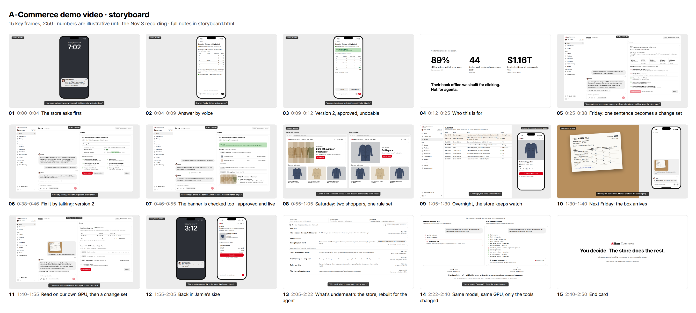

# Demo video storyboard (Nov 1)

15 key frames for the 2:50 submission video, drawn as static HTML with the running app's look: Astryx neutral theme, the Ailism red, Pretendard, Heroicons. Open `storyboard.html` in a browser: under each frame are the voiceover, what exists and what to build, and where each new element comes from. `frames/` has the 1920×1080 PNGs.

## The story

One week in one store, store clock Fri Nov 6 – Fri Nov 13, 2026. The video opens on Sunday morning (01–03), then goes back to who this is for (04) and to Friday (05).

| Store time | What happens | Frames |
|---|---|---|
| Fri Nov 6, 11:02 | The owner asks for the VIP weekend sale (scene B1, change set #1042). v1 fails 2 of 6 checks; the owner fixes it by talking; v2 is approved and goes live with a Muse Image banner that Glimmer read back. | 05–07 |
| Sat Nov 7 | Jamie (VIP) sees the sale, Alex doesn't. The Cotton utility jacket in M sells out at 21:40; Jamie taps “Notify me” at 21:52. | 08–09 |
| Sun Nov 8, 02:14 | The stock-out watcher hands the jacket to the agent; at 02:15 the agent drafts reorder PO 1044: 88 units, $4,400, from `suggest_reorder`. | 09 |
| Sun Nov 8, 07:02 | Notification on the owner's phone. “Make XL ten and approve” makes v2 (93 units, $4,650), approved at 07:03 and still undoable. | 01–03 |
| Fri Nov 13, 15:10 | The box arrives. Glimmer reads a photo of the packing slip on our GPU: XL 8 of 10. Change set #1046 receives the box, sets XL to what came and alerts the 11 shoppers waiting for M. | 10–11 |
| Fri Nov 13, 15:12 | Jamie gets the alert; the shopping assistant prepares the order at $118.00 (the sale ended Sunday) and only Jamie can place it. | 12 |

Then what is underneath (13): the store rebuilt for the agent, drawn as the five principles of [docs/design.md](../../docs/design.md#principles), each row with the moment of the story it made possible and the Meta models placed where they run. The comparison on the same model and GPU, with the honest fail count, proves it (14), and the end card closes (15).

The hero product is the Cotton utility jacket because it is in the B1 sale ($118.00 → $94.40), so the sale causes the sell-out, the reorder and the restock alert. The linen shirt from the seeded reorder (#1041) is not summer outerwear, so it could not carry the chain.

## What to build

From the notes under each frame. **General** is useful beyond the video; **case-specific** is a setting for the recording only.

| Item | Frames | Kind | Owner |
|---|---|---|---|
| ~~The B1 scene end to end~~: done in PR #99. The request ends as change set v1 with 3 items and 2 failed checks in 4 of 5 eval runs on Nov 1 (it never did before). The miss lost the banner when a revised plan wrote its own promotion id. | 05–07, 14 | general | |
| Phone layout for a task and its change set (today the tables squeeze to one letter per line) | 02, 03, 10 | general | |
| Mic in the composer → Muse Voice Transcribe, with keyword biasing from the store's product and size names (the API supports it: [docs](https://dev.meta.ai/docs/speech-to-text)) | 02 | general | |
| Camera and photo attach; image parts sent to Glimmer with the turn. Checked on Oct 31 with one synthetic slip (PO, 4 lines, total and the back-order note right, 17.9 s); real phone photos not tried yet. | 10, 11 | general | |
| “Read from the photo” block: what was read, set against the order | 11 | general | |
| A short PO number on each reorder, so a slip can point at it | 03, 10, 11 | general | |
| `generate_image` calls Muse Image (a stub today; fallback: the product's own garment picture) and a “picture matches the brief” check that Glimmer runs before the item can run | 07, 08 | general | |
| “Notify me when M is back” on the product page (`subscribe_restock` exists, the button doesn't) | 09 | general | |
| Activity rows in the store's words (today: tool names and record ids) | 09 | general | |
| A line under each reply with the tool calls, the model and where it ran | 05, 06, 11 | general | |
| “Changed from v1” at the top of the change set block (today: Compare with v1 on the page) | 06 | general | |
| Push to the owner's phone (Web Push from the installed back office; fallback: open on frame 02) | 01 | general | |
| Run the held-out set for both tool sets under the current scorer and fill the `__` on frame 14. `docs/design.md` allows only held-out numbers in a public claim; the facade has never run on it, and the README's 21/36 is the design set before the #86 scorer fix | 14 | general | |
| Frame 13 builds in the voiceover's order; drop the dashed models that are not running by the recording | 13 | case-specific | |
| Simulator demand for the sale weekend, store clock jumps, the slip printed from the reorder with one XL line short | 08–10 | case-specific | |

## Numbers

- **From the repo:** the B1 prices, checks, coupon and undo date ([docs/scenarios.md](../../docs/scenarios.md) B1); the tool calls on frames 05 and 14, from a Nov 1 eval run of PR #99 (11 up to v1; across 10 runs, 10–14 over both turns and 44–62 s); the facade trail on frame 14 (`getMbrGrdList` ✗, `getPrdGridList` ✗, 5 model calls, 22.6–23.8 s, 0 of 3 runs; [eval/results/2026-10-31-glimmer-design-facade-1.md](../../eval/results/2026-10-31-glimmer-design-facade-1.md)); the reorder formula, its 2 checks, the $1,000 approval threshold, and receive → `set_variant_stock` → restock alerts ([docs/api/catalog.md](../../docs/api/catalog.md)).
- **Illustrative**, worked out with the store's formulas, until the recording replaces them: the jacket's sales and stock (sold XS 2 · S 5 · M 13 · L 8 · XL 2, on hand 2 · 4 · 0 · 3 · 3, so the order is 6 · 13 · 41 · 23 · 5 = 88 at $50.00), the slip, PO 1044, #1046, the 11 waiting shoppers, order numbers and times.
- **Placeholders:** the `__` on frame 14 until the Nov 3 run.
- **Frame 04:** 89% of Etsy sellers are one-person businesses ([Etsy 2024 Global Seller Census](https://storage.googleapis.com/etsy-extfiles-prod/2025_Q1_GLOBAL_Seller%20Census%202024.pdf), Ipsos, n=2,402); 44 tools in a small business, not e-commerce only ([Sage and Strand Partners, Sep 2026](https://www.sage.com/en-gb/-/media/files/company/documents/pdf/digital-newsroom/sage-the-hidden-cost-of-app-switching.pdf)); $1.16T lost to out-of-stocks a year, a model estimate mostly for stores ([IHL Group Inventory Distortion 2025, via Board](https://www.board.com/wp-content/uploads/2025/11/Board-Infographic_IHL-Distortion-Study_chapter-1.pdf)).

All people and companies in the frames are made up (Jamie, Alex, Harbor & Pine Garment Co.).

## Files

| File | What it is |
|---|---|
| `storyboard.html`, `demo.css` | The frames, each 1440×810 CSS px, with notes. Pretendard must be installed locally to match the app. |
| `frames/f01.png` … `f15.png` | 1920×1080 captures |
| `overview.png` | The contact sheet above |
| `assets/` | Brand images from `web/public/brand`; garment drawings saved from the storefront's `/media/garment/<file>` route (`web/src/app/media/garment/[file]/route.ts`) |
| `render.py` | Re-renders the frames, the sheet, and the README's architecture picture `docs/img/ai-native-architecture.png` (frame 13 without the models not running yet, the story's moments and the subtitle): `python design/demo/render.py` (Python Playwright with Chromium) |
