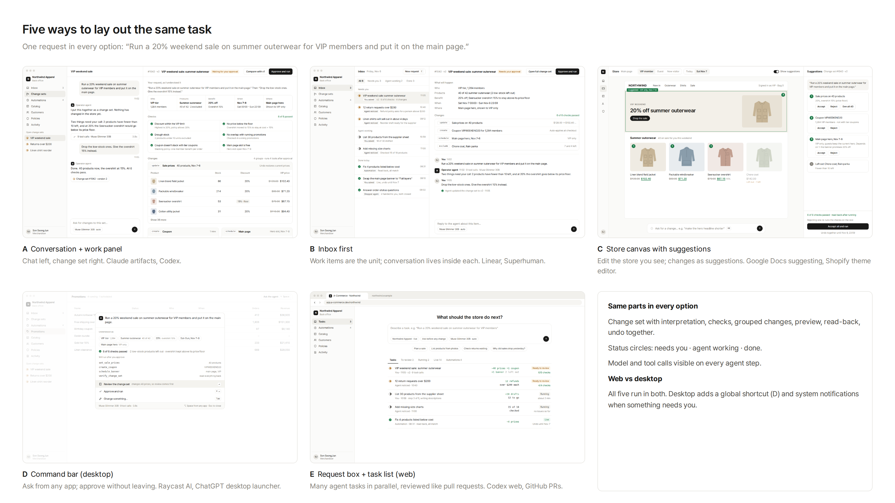
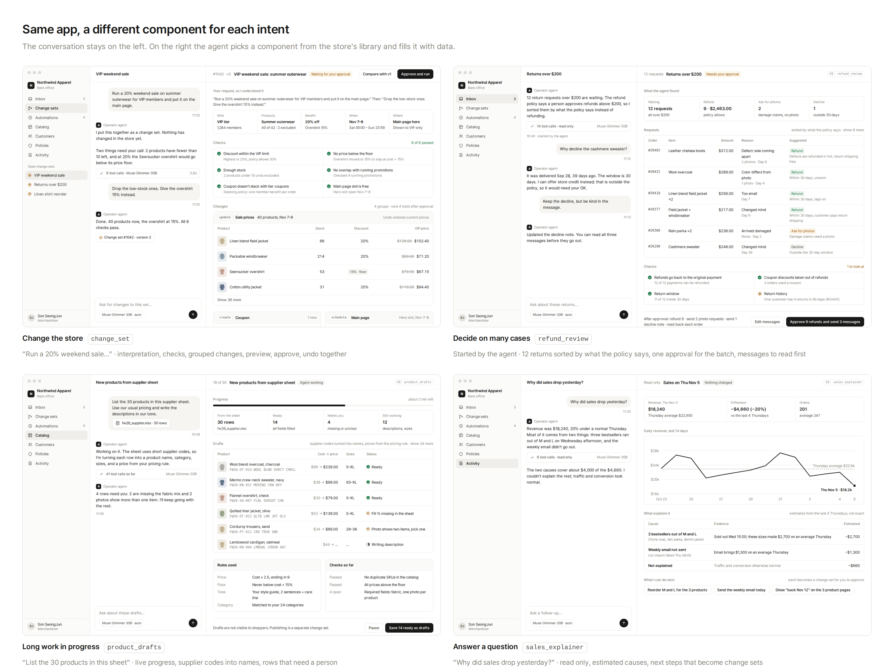

# Layout options

Five layouts for the operator app, all showing the same request: *"Run a 20% weekend sale on summer outerwear for VIP members and put it on the main page."* Same data as [the mockups](../mockups) (40 of 42 products, overshirt at 15%, 1,284 VIP members, Nov 7–8).

| Option | What is primary | Good at | Weak at | Reference |
|---|---|---|---|---|
| **A. Conversation + work panel** ([mockup](../mockups/changeset.png)) | The conversation | Going back and forth on one task; the change set stays visible | Many tasks at once; finding past work | Claude artifacts, Codex desktop |
| **B. Inbox first** ([b-inbox](b-inbox.png)) | Work items | Agent-started work (low stock, returns) sits next to requests; triage | Long back-and-forth feels secondary | Linear inbox, Superhuman |
| **C. Store canvas** ([c-canvas](c-canvas.png)) | The store as shoppers see it | Visual changes (banners, prices on cards); preview per audience and date | Changes with no visual (coupon rules, policies); bulk edits | Google Docs suggesting mode, Shopify theme editor, Figma comments |
| **D. Command bar** ([d-command](d-command.png)) | Whatever screen you are on | Quick asks and approvals from anywhere (desktop global shortcut) | Reviewing large change sets; needs a full view behind it | Raycast AI, ChatGPT desktop launcher, Linear ⌘K |
| **E. Request box + task list** ([e-tasks](e-tasks.png)) | The list of tasks | Several agent tasks in parallel; diff-like summary per task | One task's detail is a click away | Codex web, GitHub pull requests |

These are not exclusive. One app can use E or B as home, A as the task view, C for display changes, and D as the desktop shortcut.

Every option keeps the same parts: change set (interpretation, checks, grouped changes, preview, read-back, undo together), Linear-style status circles, and the model and tool-call count on each agent step. White background, no colored side bars, gradients, or shadows.

Files: open the `.html` files in a browser; captures are 1440×900.

## UI per intent

The layouts above decide where things go. This part shows what goes in the work panel: the agent picks a component from a fixed library and fills it with data, so the screen changes with the task.

| Intent | Component | Screen | What is different |
|---|---|---|---|
| Change the store | `change_set` | [changeset](../mockups/changeset.png) | Interpretation, checks, grouped changes, preview, undo together |
| Decide on many cases | `refund_review` | [intent-returns](intent-returns.png) | Started by the agent; 12 returns sorted by policy; one approval for the batch; messages read before sending |
| Long work in progress | `product_drafts` | [intent-listing](intent-listing.png) | Live progress; supplier codes turned into names and prices from the pricing rule; rows that need a person; drafts are not published |
| Answer a question | `sales_explainer` | [intent-insight](intent-insight.png) | Read only; estimated causes that add up to the gap, with the unexplained part shown; next steps become change sets |

Numbers stay consistent with the other screens: the chore coat and rain parka are the low-stock products left out of the VIP sale, and the same two are out of M and L in the sales question. The component name is shown in the header (`UI: refund_review`) only for the mockups.

## Review notes (Oct 27)

Fixed:

- B and E now show the same work items as the [inbox mockup](../mockups/inbox.png) (12 returns, linen shirts in about 4 days, 30 products from the supplier sheet, and so on).
- The promotion count is the same everywhere: 4 running (D's table and A's overlap check).
- D's default action is "Review the change set". Approving straight from the bar is still possible, but a change that moves 40 prices should not default to it.
- C shows that suggestions depend on each other (the banner promises 20% off, so it needs the price change) and that rejecting one re-runs the checks.
- E no longer shows left-out products as a deletion (red −2); they are "2 left out".
- B and E drop the duplicate "Open change sets" list from the sidebar, since the inbox and task list already hold them.

Still open:

- Times and tool counts (3.8s, 9 tool calls) are illustrative, not measured.
- Shopper side (storefront) is only in the earlier mockups, not in these options.
