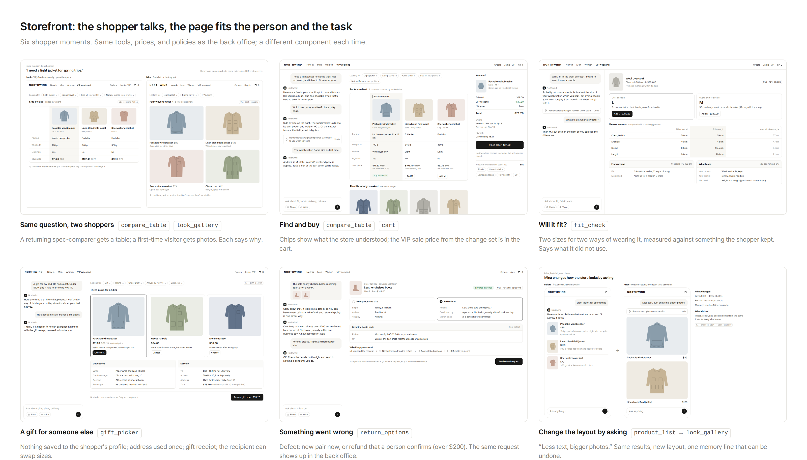

# Storefront (FO): plan and mockups

## Goal

On the storefront, the shopper talks and the page is put together for that person and that task. Personalization is not a recommendation carousel; it covers what is shown *and how it is shown*, and the shopper can change both by asking.

## Shoppers in the mockups

All names are made up.

| Shopper | Situation | What the store knows |
|---|---|---|
| Jamie | VIP, 6 orders, usually opens the specs | Size M, natural fabrics, layers hoodies (all visible and editable) |
| Mina | First visit, on a phone | Nothing yet |
| Alex | Bought boots a week ago; the sole is coming apart | The order and its photos |

## Principles

1. **The conversation is the search box, the filters, and the settings.** What the store understood is shown as chips the shopper can remove.
2. **One component per intent, fitted to the person.** The agent picks from the store's components and says why ("Shown as a table because you compare specs. Say 'show photos' to change it.").
3. **Memory is visible and can be undone.** Each new memory appears as one line with Undo. Requests about someone else (a gift) are not saved to the shopper's profile.
4. **The agent prepares; the shopper commits.** Orders and refund requests are sent only by the shopper.
5. **Say what was not used or not known.** The fit check lists the data it used and the data it did not have.
6. **One set of tools and policies.** Prices, stock, and return rules come from the same tools as the back office and outside agents, so the VIP price from the operator's change set is the price Jamie sees.

## Intents and components

| Intent | Component | Screen | Shopper tools behind it |
|---|---|---|---|
| Explore by look | `look_gallery` | [fo-two-shoppers](fo-two-shoppers.png) (right), [fo-mobile-adapt](fo-mobile-adapt.png) | `search_products` |
| Compare | `compare_table` | [fo-two-shoppers](fo-two-shoppers.png) (left), [store](../mockups/store.png) | `search_products`, `compare_products` |
| Fit | `fit_check` | [fo-fit](fo-fit.png) | `get_product_measurements`, `get_my_orders`, `get_review_summary` |
| Gift | `gift_picker` | [fo-gift](fo-gift.png) | `search_products`, `get_delivery_dates`, `prepare_gift_order` |
| Buy | `cart`, confirm sheet | [store](../mockups/store.png), [mobile confirm](../mockups/mobile-confirm.png) | `prepare_order` (the shopper places it) |
| Return or exchange | `return_options` | [fo-return](fo-return.png) | `get_order`, `get_return_options`; the shopper sends the request (person-only `POST /v1/fulfillment/returns`) |
| Change the layout | `product_list` → `look_gallery` | [fo-mobile-adapt](fo-mobile-adapt.png) | `update_my_preferences` |

Tool names follow the rules in [docs/design.md](../../docs/design.md): plain verb_noun, safe reads, writes that the person confirms.

## How the storefront and back office connect

| Storefront | Back office |
|---|---|
| Jamie pays $71.20 for the windbreaker on Nov 7 | The VIP weekend change set #1042 ([changeset](../mockups/changeset.png)) |
| Alex's refund request for boots, order #20402, $312.00 | Appears in "Returns over $200" for a person to approve ([intent-returns](../options/intent-returns.png)) |
| "Refunds over $200 are confirmed by a person" | The same refund policy the operator agent cites |
| Chore coat and rain parka are short on stock | Left out of the VIP sale for low stock |

## What we would measure

Planned, not measured yet:

- Task success on a fixed set of shopper tasks (find, compare, fit, gift, return)
- Turns until the shopper decides
- How often the shopper removes a chip or changes the layout (a sign the agent guessed wrong)
- Same answer and same layout across repeated runs of the same request

## Things the agent does not do

- Place an order or send a refund request for the shopper
- Use body measurements or photos for sizing unless the shopper shares them
- Invent urgency: stock counts are real stock from the tools
- Save details about other people (gift recipients, their addresses) unless the shopper asks

## Files

Open the `.html` files in a browser; captures are 1440×900. The earlier storefront mockups are in [../mockups](../mockups) (`store`, `mobile`).
