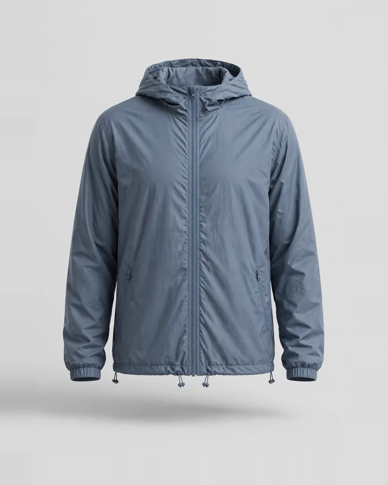
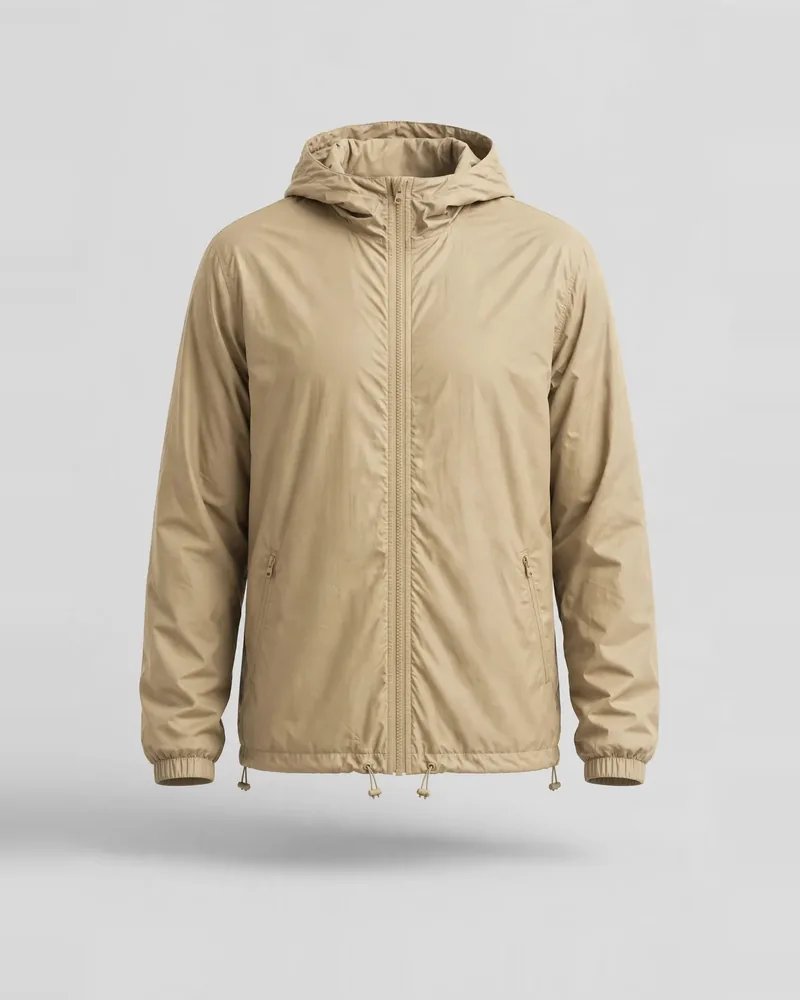
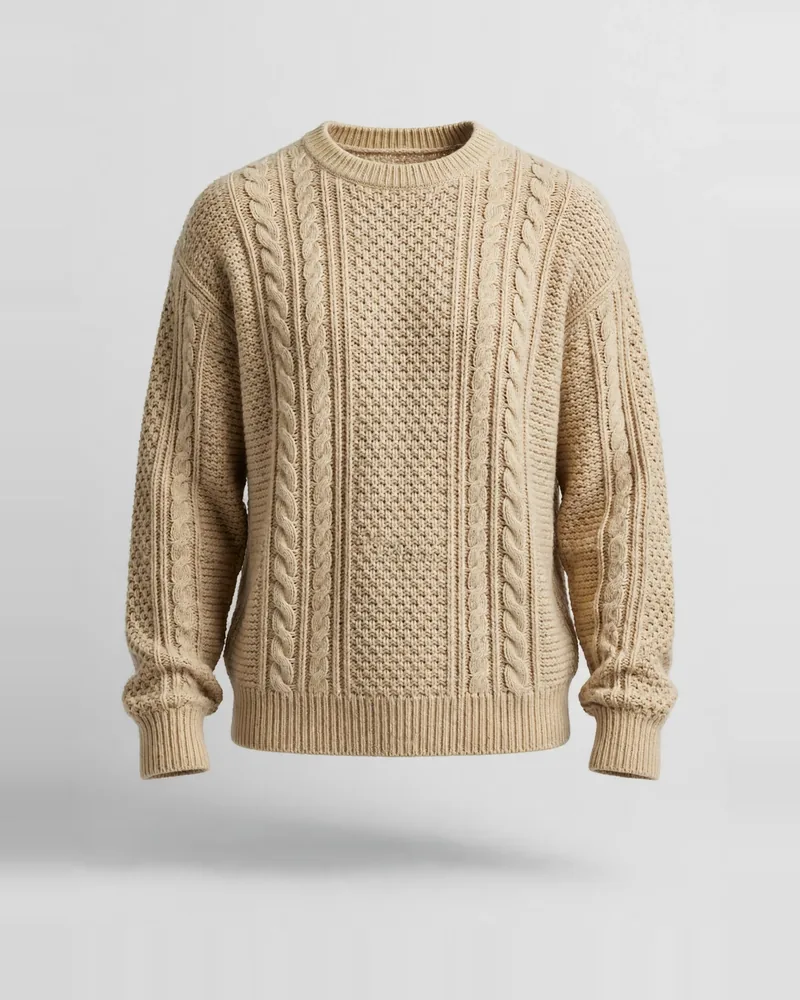
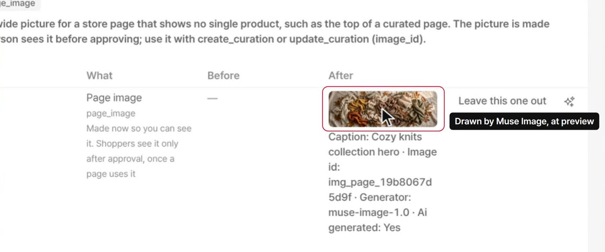
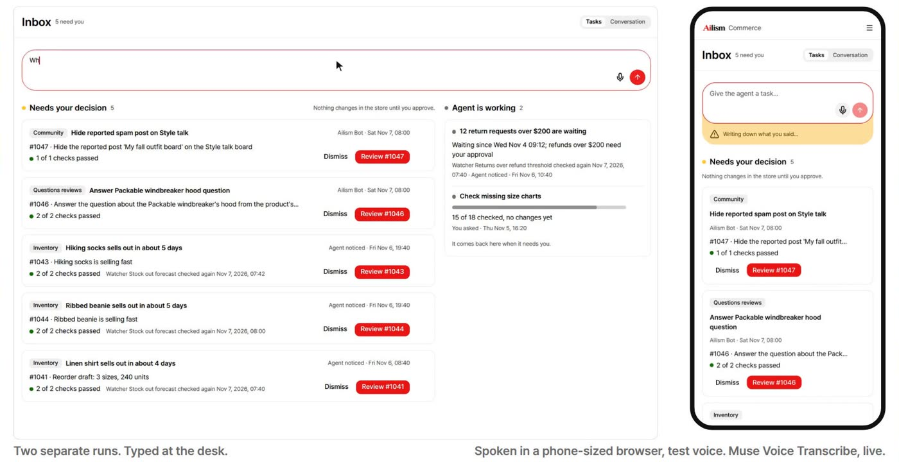

# How we used Meta models, and the proof

[README](../README.md) › [docs](README.md)

Every number here comes from our own call logs or from files in this repository, and the commands below can be run on a checkout. Response ids can only be confirmed by Meta; what a reader can check is that they are consistent across the photos, the seed and the call lists.

| Model | What it did | How much | Proof |
|---|---|---|---|
| **Muse Image** | The photos of all 1,009 demo products, one for each color; the picture at the top of a curated page, at preview | 2,094 images made in 2,128 recorded calls, 2,051 photos in the store | Each photo names its API response; [the list of every call](evidence/muse-image-calls.csv); screenshots |
| **Muse Glimmer 30B** | Every agent step on the live demo; offline, the copy of 991 products and the text of 4,140 reviews | 390 evaluation runs on Nov 3; 6,390 content calls, 4.1 million tokens | [Evaluation reports](../eval/results/2026-11-03-glimmer-judged.md); [the list of every content call](evidence/glimmer-content-calls.csv); [how we serve it](serving.md) |
| **Muse Voice Transcribe** | The composer's microphone | Shown live in the demo video, with a test voice | The code and a screenshot; no call log is kept |
| **Muse Spark** | Wired as planner and fallback, off on the live demo | No result here comes from it | [agents/models.yml](../agents/models.yml) |

## Muse Image

### Every photo names the response that made it

Each file carries the model and the response id in its metadata, and the mark for AI-generated media (IPTC `trainedAlgorithmicMedia`).

```bash
grep -ao 'Generated with Muse Image[^"]*' web/public/media/products/prd_windbreaker-7f4a8e8c.webp
```

```text
Generated with Muse Image (muse-image-1.0), Meta Model API; response resp_6ae5fef677ff100885c34e86
```

The same id is in the seed beside the product, and in the call list with its time and latency. All 2,051 files have an id, and all of them are in the call list; so are the 2,041 ids the seed names. This prints how many files are missing from the list, which is 0:

```bash
for f in web/public/media/products/*.webp; do grep -ao 'resp_[0-9a-f]*' "$f" | head -1; done | sort -u > /tmp/photo-ids.txt
cut -d, -f8 docs/evidence/muse-image-calls.csv | sort -u | comm -23 /tmp/photo-ids.txt - | wc -l
```

| | | |
|---|---|---|
|  |  |  |

### A real call

The first call of the full run, with the prompt shortened:

```text
POST https://api.meta.ai/v1/responses
{
  "model": "muse-image-1.0",
  "input": "Product photo for an online clothing store: a warm white glasses case. ...",
  "tools": [{"type": "image_generation", "enable_image_search": false, "enable_web_search": false,
             "enable_shell": false, "reasoning_strength": "high", "size": "1024x1536", "output_format": "webp"}],
  "store": false
}

200 in 10.6 s: {"id": "resp_6ae5e04ebaa095ab2147454d", "status": "completed", "model": "muse-image-1.0", ...}
```

Image search and web search are off, so the pictures are drawn from the prompt and no outside product image goes in.

### Every run

Times are in UTC. Cost is what our tool recorded at $0.01 an image.

| Run | What it made | Images | Refused | Cost |
|---|---|---|---|---|
| `20261031-204348-check`, `-204419-check`, `20261101-003230-check` | Checks of the API's format | 2 | 1 | $0.02 |
| `20261031-204707-pilot` | Pilot, reviewed by a person | 12 | 0 | $0.12 |
| `20261031-213410-full` | The first color of the generated products | 389 | 8 | $3.89 |
| `20261031-234459-named` | The 18 products the scenes name | 18 | 0 | $0.18 |
| `20261101-003315-colors` | Their other colors | 428 | 0 | $4.28 |
| `20261104-112547-more-pilot` | Pilot for the 609 new products | 31 | 1 | $0.31 |
| `20261104-112844-more-full` | The first color of the new products | 592 | 15 | $5.92 |
| `20261104-122044-more-colors` | Their other colors (6 more calls got no reply) | 619 | 3 | $6.19 |
| `20261104-140457-fix`, `-140515-fix-colors` | One product redone | 3 | 0 | $0.03 |
| **Total: 2,128 calls, Oct 31 to Nov 4** | | **2,094** | **28** | **$20.94** |

2,051 of the 2,094 images are in the store. The others are pilots, checks and photos that were redone.

### In the product

`generate_page_image` ([code](../crates/domains/catalog/src/page_image/generate_page_image.rs)) draws the picture at preview, so the person approving sees it first, and marks it as generated. Without `META_API_KEY` and `IMAGE_MODEL` it makes a placeholder that says so. From the demo video:




## Muse Glimmer 30B

### The agent, live

Open weights on our own GPU: NVIDIA's 4-bit build on vLLM, one RTX 5090 ([docs/serving.md](serving.md)). The runtime stores every model call with its model, so a running stack can answer this itself, as the database owner:

```sql
SELECT model, count(*) FROM agent.model_call GROUP BY model;
```

On Nov 3 every model call of the 390 runs in [Results](../README.md#results) went to it: [the judging](../eval/results/2026-11-03-glimmer-judged.md), and the reports for held-out on [A-Commerce tools](../eval/results/2026-11-03-glimmer-heldout-acom.md), [the facade](../eval/results/2026-11-03-glimmer-heldout-facade.md) and [a2api](../eval/results/2026-11-03-glimmer-heldout-a2api.md).

### The store's text, offline

The facts come from our vocabulary by rule. Glimmer writes from those facts, and a second call re-reads the text against them. Each product in [seed/demo/catalog_content.yml](../seed/demo/catalog_content.yml) names its run and model.

| Run | What it made | Calls answered | Tokens |
|---|---|---|---|
| `20261031-165220-v2` | Descriptions, summaries and tags of 381 products | 1,439 of 1,450 | 1,171,481 |
| `20261031-232104-denim06-white` | One product after its rename | 3 of 3 | 1,495 |
| `20261104-112445-more` | The same for 608 new products | 1,510 of 1,510 | 1,184,310 |
| `20261104-140415-more-fix` | One product redone | 4 of 4 | 3,174 |
| `20261104-120737-full` | Review text | 3,403 of 3,407 | 1,747,014 |
| `20261104-155125-rain-layers` | Reviews of two named products | 16 of 16 | 7,889 |
| **Total: 6,390 calls** | | **6,375** | **4,115,363** |

The reviews are generated store data, not from real shoppers, and the file says so.

## Muse Voice Transcribe

The microphone sends a recording to [services/agent/src/voice.rs](../services/agent/src/voice.rs), which hands it to the model with the names on the screen as spelling hints ([docs/api/chat.md](api/chat.md) §4). The words go into the composer, and the person reads them and presses send. It is used when `META_API_KEY` and `VOICE_MODEL` are set. We keep no log of these calls, so this is the one model here without a list; the video shows it working, on the right, with a test voice.



## About the call lists

- [evidence/muse-image-calls.csv](evidence/muse-image-calls.csv): run, product, attempt, time, latency, HTTP status, model, response id, request id, cost.
- [evidence/glimmer-content-calls.csv](evidence/glimmer-content-calls.csv): run, what it made, stage, product, attempt, time, latency, HTTP status, model, response id, tokens.

They are extracted from the logs each run wrote, keeping only these fields. The full logs hold every prompt and output and stay outside the repository. Neither list holds a key or the address of our server.
