# AI-native commerce: research (final, Oct 27, 2026)

What AI-native commerce means, who else is building it, and where A-Commerce fits. Most sources are vendor pages, press releases, and secondary coverage; vendor numbers are their own claims, not independent measurements. Items marked *(unverified)* come only from third-party summaries. Captures were taken on Oct 27, 2026 (top of each page, 1440×900) and are kept here for reference; the linked pages are the source of record.

Contents: 1–4 what AI-native commerce is · 5–7 the landscape · 8–10 where we fit · sources.

## 1. Where the industry is in late 2026

### Shoppers: agents moved outside the store

- **Protocols.** OpenAI and Stripe's Agentic Commerce Protocol (ACP, Sep 2025) and Google's Universal Commerce Protocol (UCP, co-developed with Shopify, Etsy, Wayfair, Target, Walmart) standardize how an agent discovers products, builds a cart, and hands off payment. Google's Agent Payments Protocol (AP2) covers payment mandates within spending limits.
- **Surfaces.** Google announced Universal Cart at I/O 2026: one cart across Search, Gemini, YouTube, and Gmail, on UCP. Amazon renamed Rufus to Alexa for Shopping (May 13, 2026), with scheduled actions ("buy only if the price drops below X") and "Buy for Me" on other retailers' sites. Naver has been running an AI shopping agent beta in the Naver Plus Store since Feb 2026, and from May 2026 combines it with membership and delivery so that a purchase can be finished inside the agent.
- **A retreat worth noting.** OpenAI moved away from Instant Checkout in March 2026: ChatGPT focuses on discovery and sends shoppers to the merchant's checkout. Reports say the first version "did not offer the flexibility it wanted". Merchants want to keep checkout, payment, and the customer relationship.

### Trust is the bottleneck, not model capability

- Riskified (Q1 2026, US/UK): about 55% of consumers are not comfortable with AI agents buying for them; 73.9% expect strong safeguards.
- ACI Worldwide/YouGov: 70% say an agent transaction made without their permission would make them stop using it.
- Visa's CPO: "it's not a question of AI model capabilities"; the problem is making it secure, permissioned, and reliable.

### Merchants: assistants on top of the admin

- **Shopify Sidekick** (Winter '26 / Spring '26): Sidekick Pulse watches store data and shows a few recommended actions as cards on the home screen; Sidekick plans multi-step work (for example, building a promotion), shows changes for approval before applying them, generates admin apps from a description, and lets teams save prompts as reusable skills. It now keeps working in the background.
- **Salesforce Agentforce Commerce** (Jul 2026): Merchant Agent (organize catalogs from plain language), Shopper Agent on the brand's own storefront, Buyer Agent for B2B on WhatsApp/SMS.
- **VTEX** (Apr 2026) calls itself an "AI-native commerce operating system": an AI Workspace with agents for catalog, promotions, and search, plus autonomous post-sales (claims "over 91% AI-assisted automation" for order status, exchanges, returns).
- In all three, the existing admin screens stay the system of record and the agent operates on top of them.

### Interfaces: from text to components the client owns

- **Shopify MCP UI** (Aug 2025): agents return interactive commerce components (variant pickers, bundles, cart). Key design choice: *components do not change state directly; they send intents back to the agent.* MCP Apps became the standard for this in early 2026; OpenAI's Apps SDK builds on it.
- **Google A2UI** (v0.9): the agent describes the UI as data and the client renders it with its own pre-built components, instead of running agent-written code.
- **Google Research, "Generative UI"**: raters preferred generated interfaces over markdown 82.8% of the time (90.5% for information-seeking prompts); human-expert sites still ranked first. Caveat: speed was not part of the evaluation, and generation often took 1–2 minutes.
- **Daydream** (fashion): each conversation refines a "Style Passport" of remembered preferences (color, fit, brands, budget, occasion). Its founder argues that keyword search tied to a site's taxonomy doesn't match how customers actually talk.

## 2. Three levels

| Level | What it looks like | Examples |
|---|---|---|
| **AI-added** | AI buttons and a chatbot on top of screens built for people. Screens are still the system. | "AI copywriter" button in the product editor, recommendation carousel, FAQ chatbot |
| **Agent-ready** | The catalog and checkout are exposed to outside agents through protocols. The back office is unchanged. | UCP/ACP catalog syndication, agentic storefronts |
| **AI-native** | The business itself can be run by agents. Tools are the primary interface, for our own agents and for outside ones. People decide; agents do the work. | What A-Commerce aims for |

## 3. Our definition

> The working principles that came out of this research are in [design.md § Principles](design.md#principles) (set Oct 31). This section keeps the research view.

**AI-native commerce is a store whose work can be done by agents, where people decide and agents carry it out, and where every screen is assembled for the task and the person in front of it.**

Five properties, each with what we build:

1. **Tools are the primary interface.** Every business action is a well-described tool. The same tool layer serves our operator agent, our shopper agent, and outside agents (MCP / UCP-style). → *AI-friendly tool layer* (design.md §3)
2. **Agents start work, not only answer.** Agents notice things (stock running out, a promotion underperforming) and propose work, the way Pulse does, then carry it through. → *Inbox with agent-proposed work*
3. **People review change sets, not screens.** Every write is grouped into a change set with a plain interpretation of the request, checks, previews, approval, and undo, similar to reviewing a pull request. This answers the trust problem: nothing reaches customers or money without a person's approval, and everything can be undone together. → *Change set review*
4. **UI is assembled per intent from components the store owns.** The agent chooses components and fills them with data (A2UI / MCP UI pattern); components send intents back. The layout changes with the person: a comparison table for someone who compares specs, a gallery for someone who browses. → *UI protocol* (design.md §6)
5. **Memory is visible and editable.** What the agent remembers about a shopper or an operator is shown, and it can be corrected or deleted. Purchases always need the shopper's own confirmation. → *"What I know about you", confirm-to-buy*

## 4. What this means for the demo

- Show a **change set**, not just a chat answer. That is the moment a judge sees the difference between "AI-added" and "AI-native".
- Show **one tool layer, several agents**: the operator agent creates the sale; the shopper agent uses the same tools and the coupon applies at checkout.
- Show **trust built into the flow**: interpretation shown before acting, checks, approval, read-back verification, undo.
- Avoid claiming speed or accuracy we have not measured.

## 5. The landscape map

Work in this space falls into seven layers. Almost everyone is building the outer layers (channels, payments, agent access to existing APIs). Few touch the inside of the store.

| Layer | Question it answers | Main players |
|---|---|---|
| A. Shopper channels | Where do shoppers meet agents? | ChatGPT, Google AI Mode / Gemini, Alexa for Shopping, Perplexity, Copilot, Naver |
| B. Agent payments | How does an agent pay safely? | ACP + Stripe, AP2, Visa Intelligent Commerce, Mastercard Agent Pay, PayPal, Shop Pay |
| C. Agent access to platforms | How does an agent reach a store? | Shopify Catalog / Storefront / Shop MCP, commercetools Commerce MCP, BigCommerce MCP, Saleor (ACP), Medusa skills |
| D. Operator agents | Who helps run the store? | Shopify Sidekick, Amazon Seller Assistant, BigCommerce Companion, Wix, Salesforce Merchant Agent, VTEX AI Workspace |
| E. AI-built stores | Can an agent team run a whole store? | Genstore |
| F. Interfaces | How do agents show UI? | A2UI, MCP Apps (MCP-UI, OpenAI Apps SDK), AG-UI, Open-JSON-UI, Google Generative UI, Thesys C1 |
| G. Tool design and evaluation | How do you make and measure tools? | Anthropic tool-writing guide, τ²-bench retail |

## 6. Details by layer
### A. Shopper channels

| Product | Date | What it is | Notes |
|---|---|---|---|
| OpenAI ChatGPT shopping (ACP) | Sep 2025; changed Mar 2026 | ACP is an open protocol (Apache-2.0) co-developed with Stripe. Merchants send product feeds; Instant Checkout let shoppers buy inside ChatGPT | In Mar 2026 OpenAI moved to discovery plus merchant checkout (through ChatGPT apps or the merchant site), saying the first version "did not offer the flexibility it wanted". Fee reports conflict (4% vs none) *(unverified)* |
| Google AI Mode, Gemini, Universal Cart (UCP) | UCP Jan 2026; Universal Cart I/O 2026 | One cart across Search, Gemini, YouTube, Gmail, built on Google Wallet; pay with Google Pay or send the cart to the merchant | UCP co-developed with Shopify, Etsy, Wayfair, Target, Walmart; supports APIs, A2A, MCP |
| Amazon Alexa for Shopping | May 13, 2026 | Rufus renamed and merged with Alexa+; scheduled actions ("buy if the price drops below X"); Buy for Me on other retailers' sites | Rufus served 300M+ customers in 2025 (Amazon) |
| Perplexity + PayPal | May 2025; holiday 2025 | In-chat checkout with PayPal/Venmo, 5,000+ merchants, retailer stays merchant of record, PayPal buyer protection applies | |
| Microsoft Copilot Checkout | Jan 2026 | Checkout inside Copilot, on Mastercard Agent Pay with PayPal *(unverified)* | |
| Naver AI shopping agent | Feb 26, 2026 beta | In the Naver Plus Store app; compares specs and reviews; from May 2026 combined with membership and N delivery to finish purchases inside the agent | Digital, living categories first |
| Cafe24 app in ChatGPT | Feb 2026 | A shopping app inside ChatGPT for recommend, compare, buy; merchants exposed to AI search ("GEO") | Korean platform, 2M+ stores |

Captures:

| OpenAI ACP docs | Google Universal Cart | Google UCP |
|---|---|---|
| 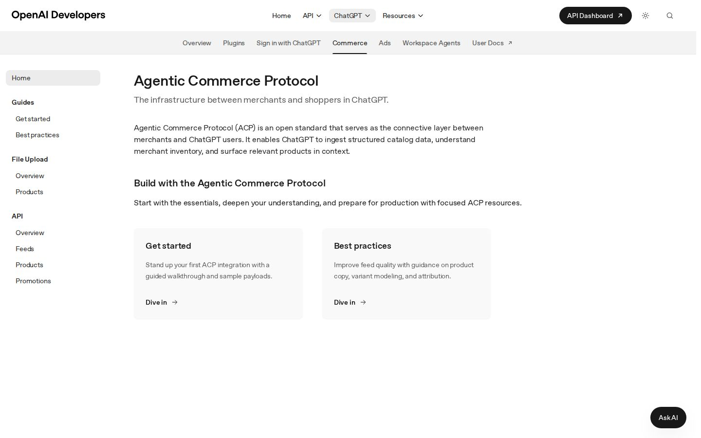 | 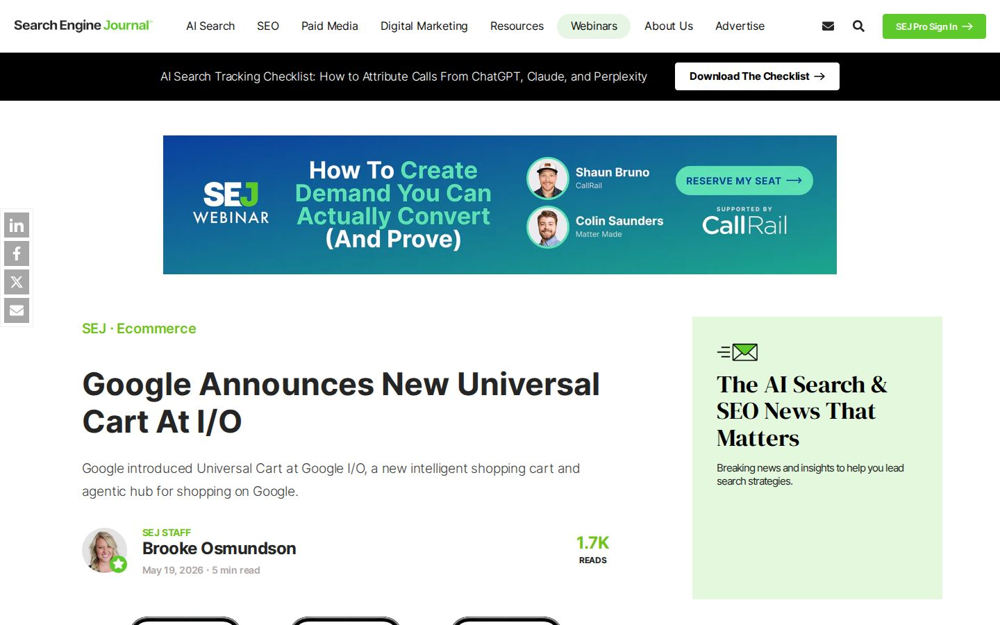 | 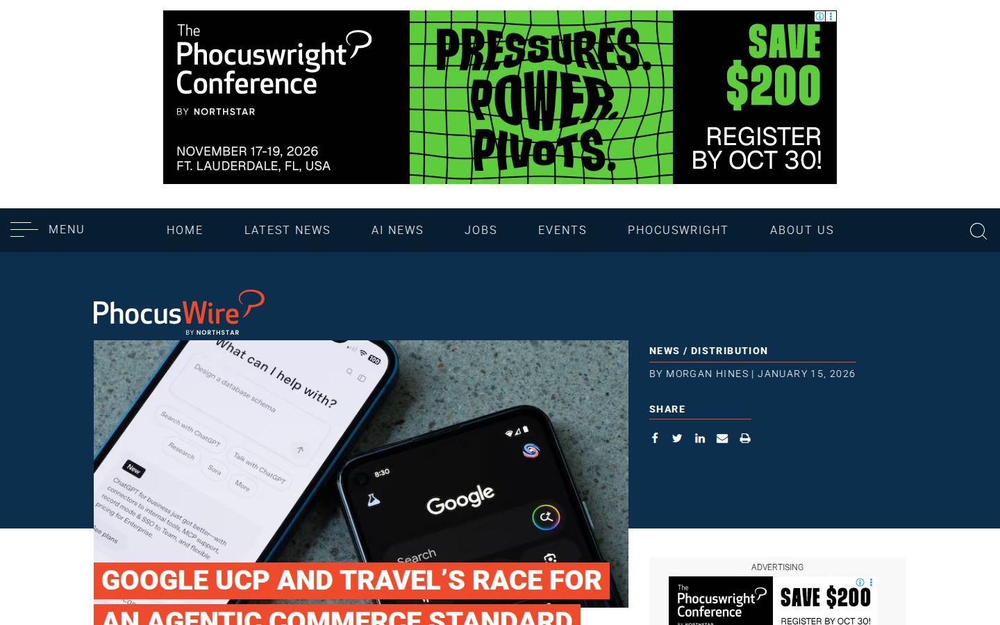 |

| Alexa for Shopping | Perplexity + PayPal | Naver AI shopping agent |
|---|---|---|
| 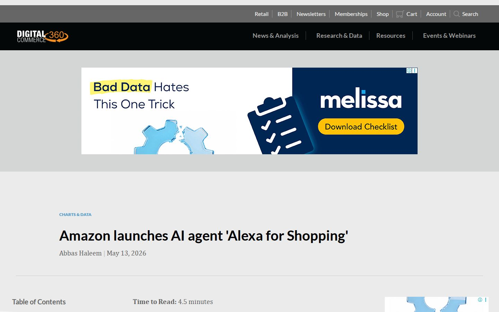 | 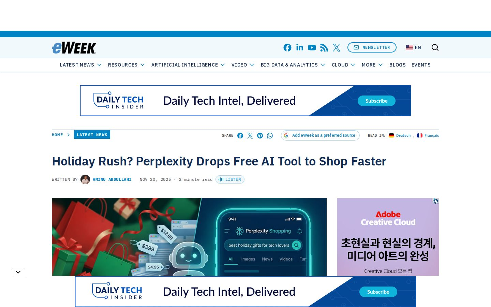 | 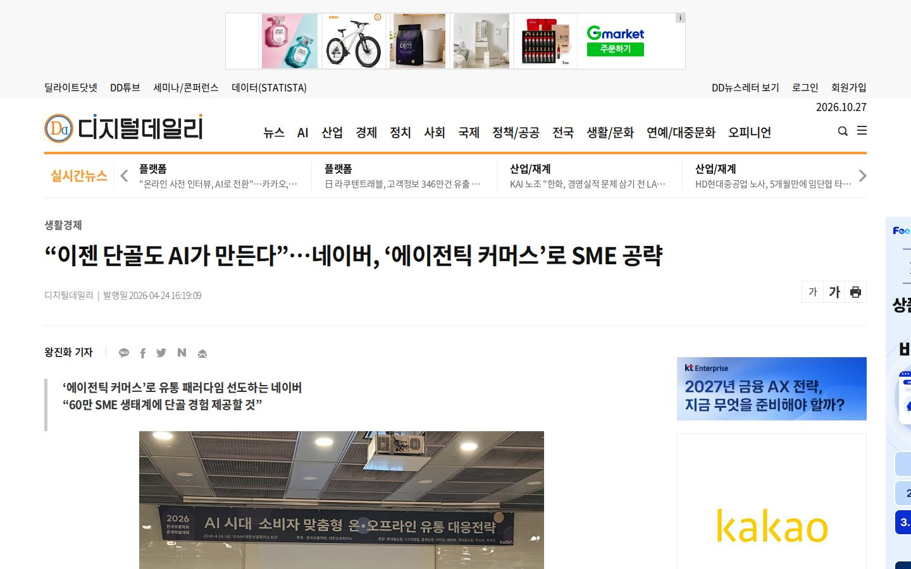 |

| Cafe24 app in ChatGPT |
|---|
| 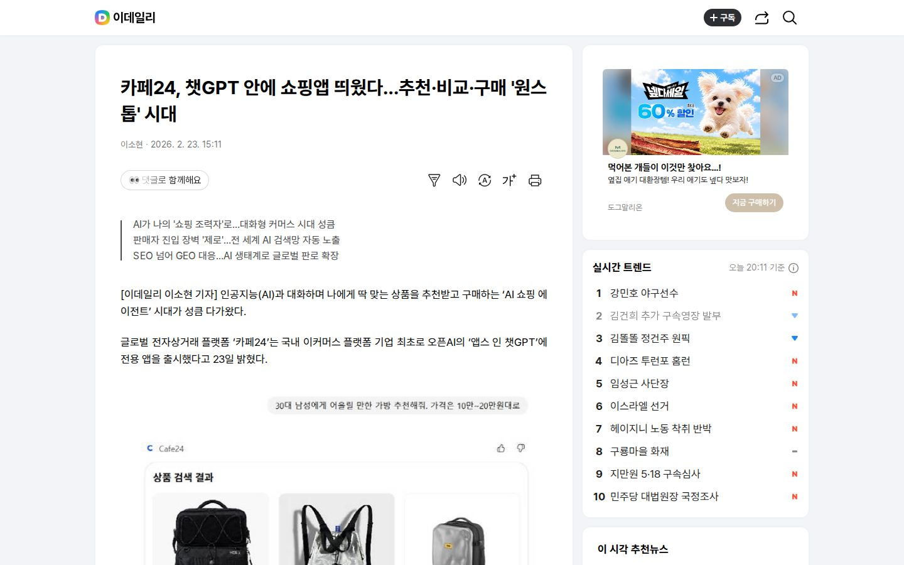 |

### B. Agent payments

| Product | What it is |
|---|---|
| Stripe (ACP, Agentic Commerce Suite) | Payment layer for ACP; Wix and others plug in through it |
| Google AP2 | Payment mandates so agents buy within set spending and brand limits; rolling out from Gemini |
| Mastercard Agent Pay | Agentic Tokens bound to one agent identity and the cardholder's mandates; all US cardholders enabled by Nov 2025 *(unverified)* |
| Visa Intelligent Commerce, Trusted Agent Protocol | Announced May 2025; in the early ChatGPT rollout the shopper approves each purchase *(unverified)* |

Pattern: **every payment path keeps a human confirmation or a mandate the human set.**

### C. Agent access to platforms

| Product | Date | What it is | Notes |
|---|---|---|---|
| Shopify Catalog MCP, Storefront MCP, Checkout MCP | 2025–2026 | Catalog search across Shopify, per-store tools, and a status-driven checkout (`incomplete` → `requires_escalation` → `ready_for_complete` → `completed`) that hands off to a trusted checkout UI when the buyer must act | Hydrogen storefronts expose `/api/mcp` |
| Shopify Shop MCP | Oct 13, 2026 | One MCP endpoint: search 1B+ products, build carts, check out with Shop Pay. `complete_checkout` only after the shopper confirms total and payment | No webhooks at launch; poll `get_checkout` |
| commercetools Commerce MCP | Launched May 2025; managed MCP GA Jul 16, 2026 | Catalogs, carts, prices, promotions, orders as MCP tools; each server config chooses which tools are exposed and can rewrite tool descriptions and output format | Industry advice: start read-only, unlock writes tool by tool |
| BigCommerce | 2025–2026 | Storefront MCP (guest shopping), B2B Storefront MCP, Store Management MCP (early access) | |
| Saleor | Feb 17, 2026 | "First fully open, end-to-end AI-native commerce stack": ACP entry (UCP, AP2 planned), Ink AI conversational search, config as version-controlled files, `.claude/skills` in the storefront | Agents use the existing GraphQL API |
| Medusa | Apr 14, 2026 | Agent skills (including one for building internal agents that "operate and manage your store"), a docs MCP, Bloom | No word on approvals or live write controls |

Pattern: **platforms wrap their existing APIs as MCP tools.** commercetools even lets you rewrite tool descriptions, which admits that raw API descriptions are not good enough for agents.

Captures:

| Shopify Shop MCP | shopify.dev agents | commercetools Managed MCP |
|---|---|---|
| 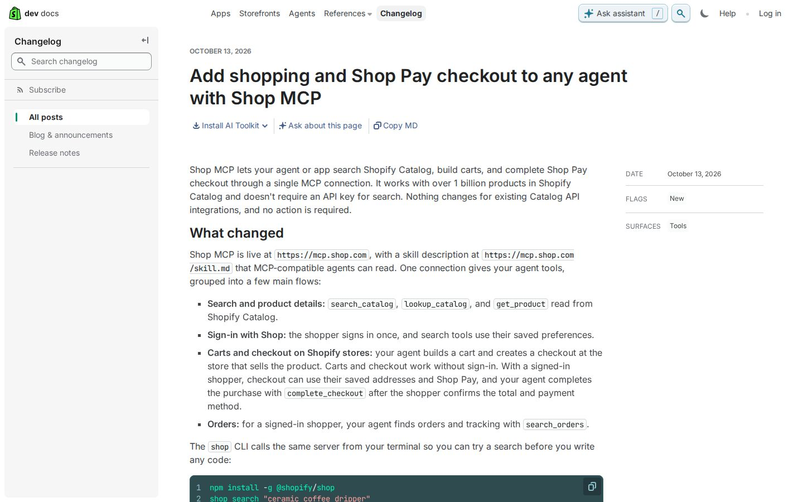 | 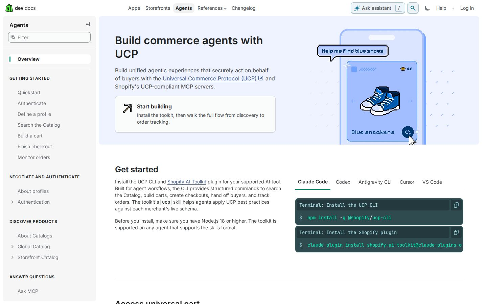 | 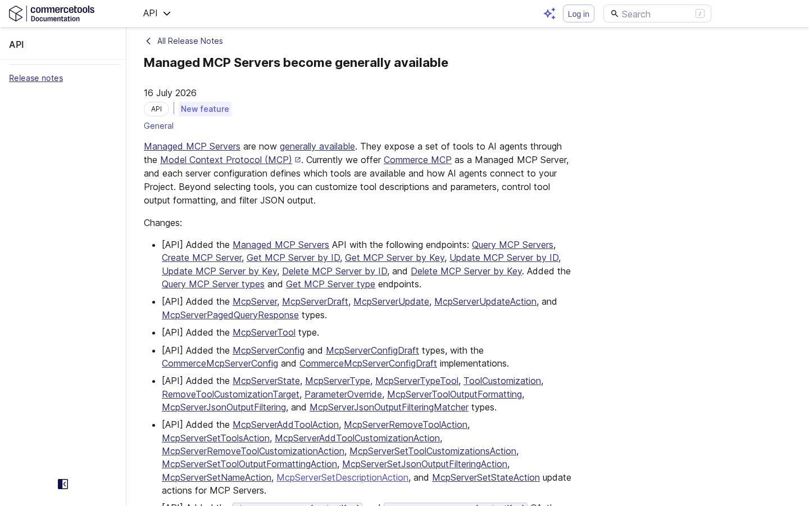 |

| BigCommerce | Saleor | Medusa |
|---|---|---|
| 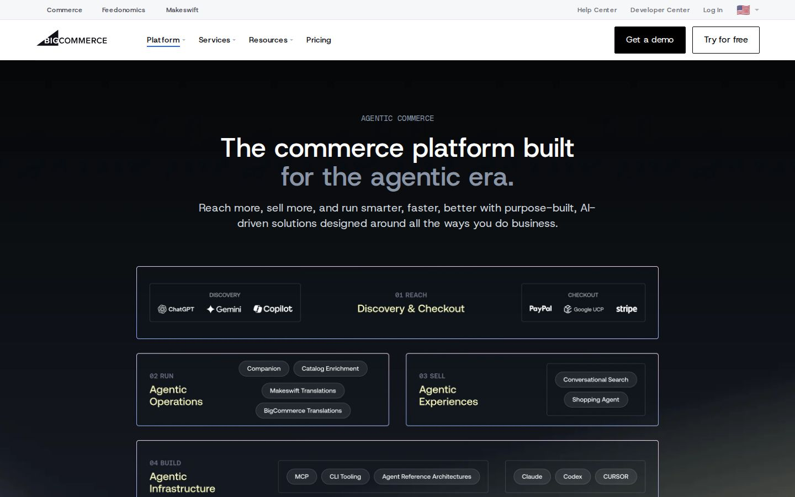 | 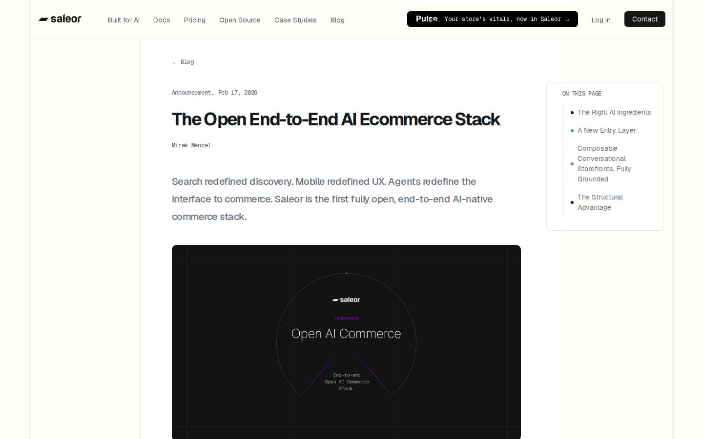 | 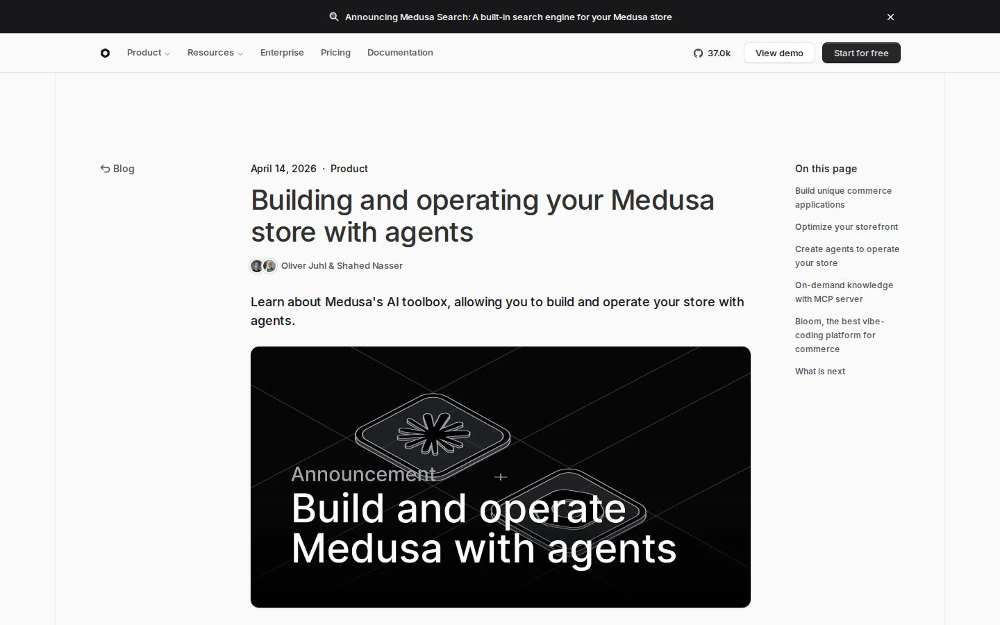 |

### D. Operator agents

| Product | Date | What it does | Control model |
|---|---|---|---|
| Shopify Sidekick | Winter '26, Spring '26 | Pulse proposes up to five actions from store data; plans multi-step work (e.g. promotions); generates admin apps; reusable skills; background work; edits product images | Shows changes for approval before applying *(secondary sources)*; Shopify-only |
| Amazon Seller Assistant (Project Amelia) | Beta Sep 2024; agentic Sep 2025 | Monitors inventory, handles compliance, creates ad campaigns; built on Bedrock (Nova, Claude) | Acts "with a seller's permission" |
| BigCommerce Companion, Smart Edits | 2025–2026 | Store-aware assistant in the control panel; describe one catalog change and apply it across many products | Early access |
| Wix Smart Chat, Harmony | 2025–2026 | Merchant agent for daily operations; AI setup and optimization | |
| Salesforce Agentforce Commerce | Jul 6, 2026 | Merchant Agent (catalog by plain language), Shopper Agent, Buyer Agent (B2B on WhatsApp/SMS) | Enterprise, Salesforce-hosted models |
| VTEX AI Workspace | Apr 16, 2026 | "AI-native commerce operating system": agents for catalog, promotions, search; autonomous post-sales (claims 91%+ AI-assisted) | |
| Naver Smart Store seller tools | Q1 2026 | Review insights, AI review summaries | Analysis, not operation |

Pattern: **an assistant on top of the existing admin, with a permission step.** None of these shows the change as a reviewable set with checks, read-back verification, and undo together, as far as public material shows.

Captures:

| Amazon Seller Assistant | Wix | VTEX Vision 2026 |
|---|---|---|
| 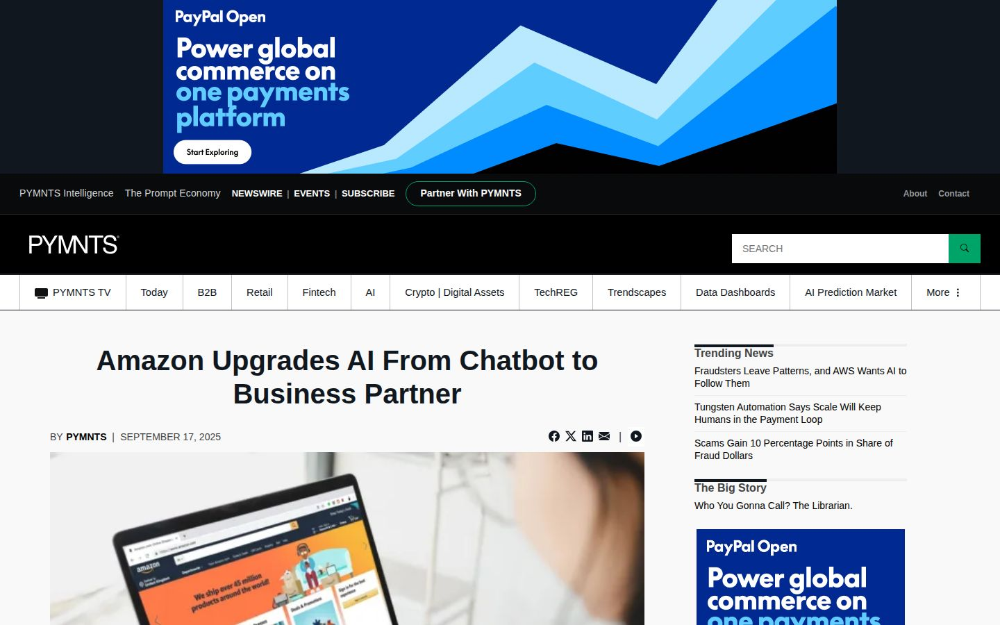 | 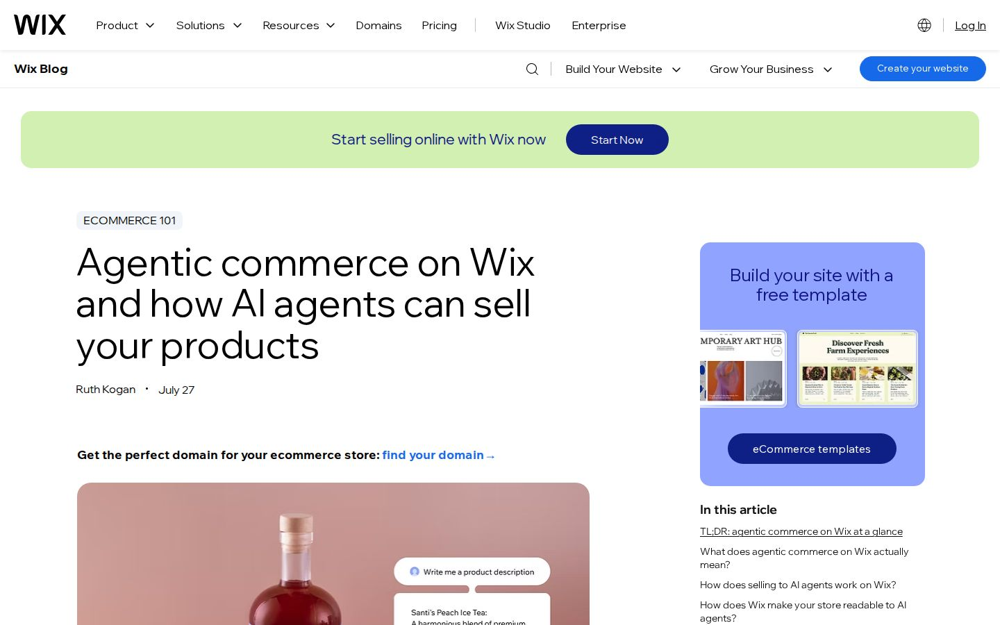 | 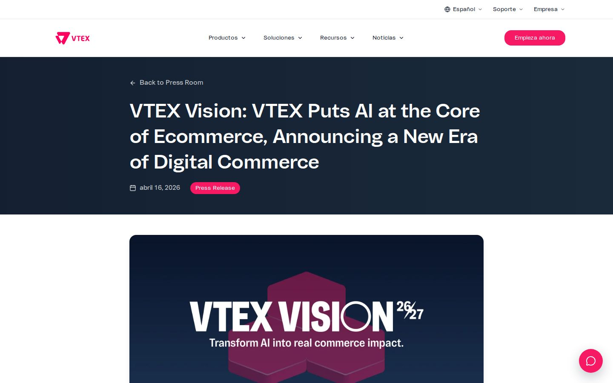 |

### E. AI-built stores

| Product | Date | What it is |
|---|---|---|
| Genstore | Seed $10M, Sep 2025; Forbes Mar 2026 | A team of agents (design, product, launch, analytics) builds a store from a description and runs it through chat *(Forbes article not directly readable; from summaries)* |

This is the closest pitch to ours in words ("agents run your store"). It targets new, small stores. It does not deal with large existing back-ends, policies, or review.

Captures:

| Genstore |
|---|
| 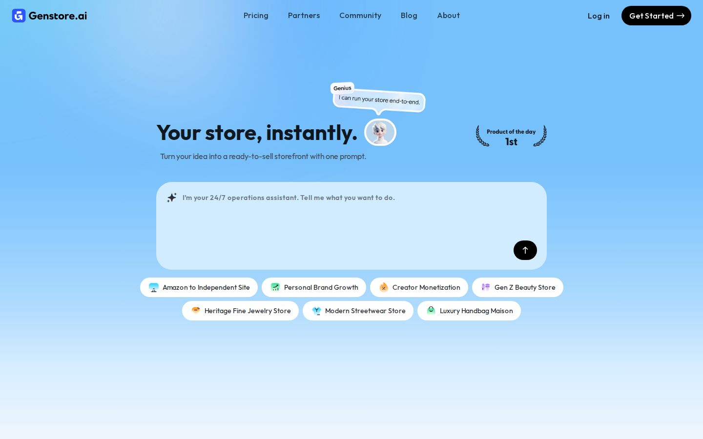 |

### F. Interfaces

| Standard | Type | Notes |
|---|---|---|
| A2UI (Google, v0.9) | Declarative: agent sends JSON(L); the client renders with its own components | Matches our UI protocol |
| MCP Apps (from MCP-UI; OpenAI Apps SDK builds on it) | Open-ended: UI resources in a sandboxed iframe | Shopify's MCP-UI: components send intents back to the agent instead of changing state |
| AG-UI (CopilotKit) | Transport for agent ↔ frontend events, not a UI spec | Can carry A2UI payloads |
| Open-JSON-UI (OpenAI) | Declarative schema *(per CopilotKit docs)* | |
| Google Generative UI | Model writes the page | Preferred over markdown 82.8% of the time; human-expert pages still best; slow (1–2 min) |
| Thesys C1 | GenUI toolkit marketed for shopping agents | Vendor claims only |

No independent case study found of a large retailer running fully agent-generated storefront pages.

Captures:

| Shopify MCP UI | CopilotKit: AG-UI, MCP-UI, A2UI | Google Generative UI |
|---|---|---|
| 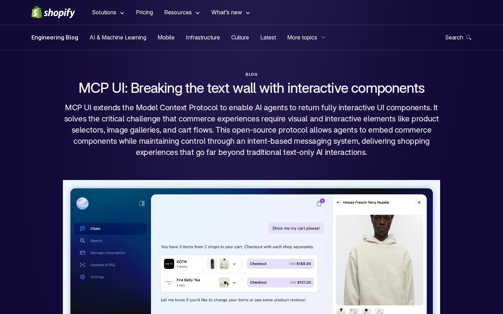 | 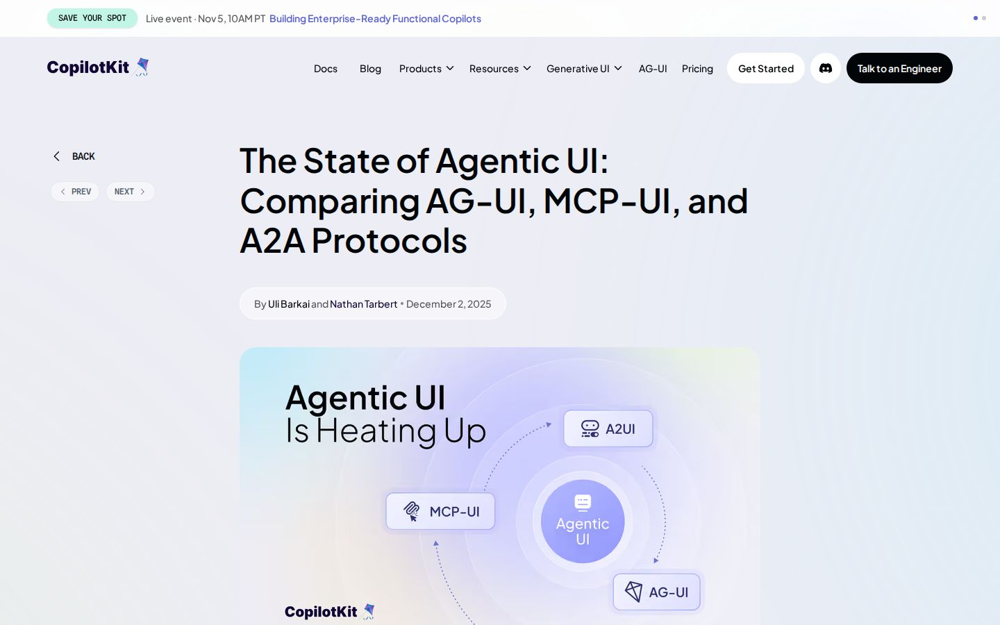 | 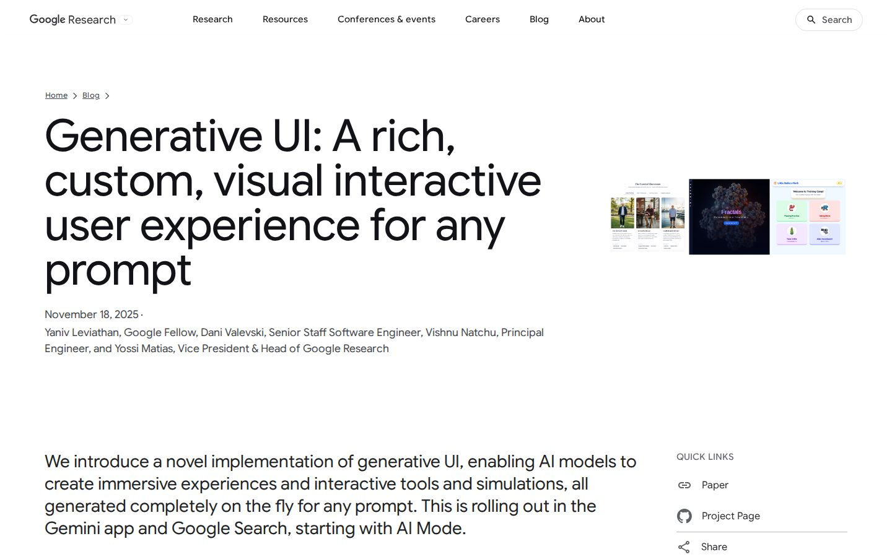 |

### G. Tool design and evaluation

- **Anthropic, "Writing effective tools for AI agents" (Sep 2025)**: build a few tools for high-impact workflows instead of wrapping every endpoint (`search_contacts` over `list_contacts`); namespace tools; return meaningful fields (names over IDs) with a `response_format` option; paginate and filter by default; write error messages that say what to do next; describe tools as to a new hire; measure tools with realistic multi-step evaluations. This matches the rules in [design.md §3](design.md) almost point for point.
- **τ²-bench retail (Sierra)**: a standard benchmark where an agent serves a simulated customer with retail tools under a policy (orders, returns, exchanges). Reported retail pass^1: frontier models around 90%, a 30B-A3B open model about 82% with a custom scaffold *(aggregator figures, not the official board)*. Useful as a method: policy document + tools + user simulator + pass^k over repeated runs.

Captures:

| Anthropic tool guide | τ²-bench |
|---|---|
| 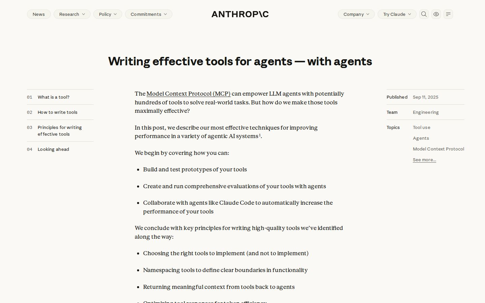 | 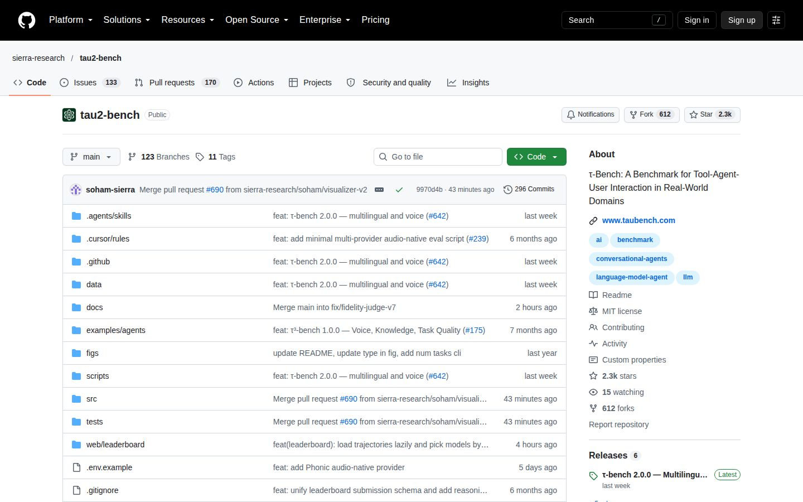 |

## 7. What this tells us

1. **The outside of the store is crowded and standardized.** Channels (ChatGPT, Gemini, Alexa, Perplexity, Naver) and protocols (ACP, UCP, AP2, MCP) are moving fast. We should not compete there; we should be compatible with it.
2. **The inside of the store is still screens plus an assistant.** Platforms wrap existing APIs as MCP tools; operator agents sit on top of admin screens with a permission step.
3. **Human confirmation is everywhere.** Shop MCP completes checkout only after the shopper confirms; payment networks bind agents to mandates; OpenAI moved checkout back to merchants. Trust is designed in, not added later.
4. **Tool quality is known to matter, but nobody shows it for commerce.** Anthropic's guide says to design and evaluate tools; commercetools lets you rewrite tool descriptions. We found no public comparison of a redesigned commerce tool layer against a wrapped legacy API.

## 8. Where A-Commerce fits

| | Wrapped API (commercetools, BigCommerce, Saleor) | Admin assistant (Sidekick, Seller Assistant) | AI-built store (Genstore) | **A-Commerce** |
|---|---|---|---|---|
| Starts from | Existing API | Existing admin | New small store | Large existing back-end, redesigned |
| Tool layer | 1:1 wrappers | Platform-internal | Platform-internal | Designed for agents (A2API), measured |
| Operator review | n/a | Approve a step | Chat | Change set: interpretation, checks, preview, read-back, undo |
| Shopper side | Through outside agents | n/a | Generated store | Same tools for our shopper agent and outside agents |
| Models | Any | Vendor | Vendor | Open weights in-house (Muse Glimmer) plus Muse Spark |
| Evidence | — | — | — | Same tasks: wrapped API vs A2API, Glimmer vs Spark |

Closest competitors to watch: **Shopify Sidekick** (operator side), **Genstore** (pitch), **BigCommerce Store Management MCP + Smart Edits** (agent writes to the admin).

How A-Commerce differs:

1. **It starts from the back-end.** We redesign a large commerce back-end into an AI-friendly tool layer (the "A2API" idea) and measure that a small open model can use it. Others either expose the existing API or build a new small-store product.
2. **Change sets.** Operator work is reviewed as a change set with interpretation, checks, preview, read-back, and undo. Sidekick has approval; nobody we found treats store changes like reviewable pull requests.
3. **One tool layer for every agent.** Our operator agent, our shopper agent, and outside agents (ChatGPT, Gemini through ACP/UCP-style endpoints) use the same tools and policies.
4. **Open weights, on our own servers.** Muse Glimmer runs inside the company, so catalog and customer data stay in-house.

## 9. What we borrow

- **Shopify Checkout MCP states** (`requires_escalation`, `ready_for_complete`) → states of our change sets and orders.
- **Shop MCP rule** (`complete_checkout` only after the shopper confirms) → our confirm-to-buy.
- **Anthropic tool guide** → A2API rules; cite it in design.md.
- **τ²-bench method** (policy + tools + simulated user + pass^k) → our evaluation of wrapped API vs A2API.
- **A2UI** → the format of our UI blocks.
- **commercetools tool configuration** → show that rewriting descriptions on a wrapped API is the baseline we compare against.

## 10. Limits of this research

- Searches and page reads in one day (Oct 27, 2026); paywalled or blocked pages (Forbes on Genstore, Salesforce newsroom, OpenAI's Instant Checkout post) were read through summaries only.
- "Nobody does X" means we did not find it in public material, not that it does not exist.
- No product here was used hands-on; claims about approval flows come from vendor descriptions.

## Sources

- OpenAI Instant Checkout and ACP: [TechCrunch, Sep 2025](https://techcrunch.com/2025/09/29/openai-takes-on-google-amazon-with-new-agentic-shopping-system/), shift in Mar 2026: [Digital Commerce 360](https://digitalcommerce360.com/2026/03/06/openai-shifts-checkout-plans-agentic-commerce-strategy/), [Checkout.com](https://cfworker-www.checkout.com/blog/openai-agentic-commerce-shift)
- Google UCP: [PhocusWire](https://www.phocuswire.com/google-universal-commerce-protocol-agentic-ai-mcp); Universal Cart: [Search Engine Journal](https://www.searchenginejournal.com/google-announces-new-universal-cart-at-i-o/575301/), [PPC Land](https://ppc.land/googles-universal-cart-wants-to-follow-you-everywhere-you-shop/)
- Amazon Alexa for Shopping: [Digital Commerce 360](https://www.digitalcommerce360.com/2026/05/13/amazon-launches-ai-agent-alexa-for-shopping/), [eMarketer](https://www.emarketer.com/content/amazon-alexa-for-shopping-rufus-integration)
- Naver AI shopping agent: [디지털데일리](https://www.ddaily.co.kr/page/view/2026042416082146478), [파이낸셜뉴스](https://www.fnnews.com/news/202604300951240870)
- Shopify Editions: [The Fintech Times](https://thefintechtimes.com/shopify-unveils-agentic-commerce-era-with-winter-26-edition/), [Coalition Technologies, Spring '26](https://coalitiontechnologies.com/blog/shopify-editions-spring-26)
- Salesforce Agentforce Commerce: [Salesforce, Jul 6 2026](https://www.salesforce.com/ap/news/press-releases/2026/07/06/as-ai-agents-transform-commerce-salesforce-unleashes-its-biggest-agentforce-commerce-release-yet/)
- VTEX: [VTEX Vision 2026](https://www.vtex.com/es-mx/press/vtex-vision-ai-native-commerce-suite-2026)
- Shopify MCP UI: [Shopify Engineering](https://shopify.engineering/mcp-ui-breaking-the-text-wall); MCP Apps vs Apps SDK: [mcp.directory](https://mcp.directory/blog/mcp-apps-standard-vs-openai-apps-sdk-2026); A2UI: [The Decoder](https://the-decoder.com/google-launches-generative-ui-standard-for-ai-agents/)
- Google Generative UI: [Google Research blog](https://research.google/blog/generative-ui-a-rich-custom-visual-interactive-user-experience-for-any-prompt/), [arXiv 2604.09577](https://arxiv.org/pdf/2604.09577), critique: [Search Engine Journal](https://www.searchenginejournal.com/googles-generated-interfaces-could-compete-con-tool-pages/586589)
- Daydream: [RetailBoss](https://retailboss.co/why-fashions-biggest-brands-are-betting-on-daydreams-shop-by-chat-ai-revolution)
- Trust: [Digital Transactions (Riskified)](https://www.digitaltransactions.net/a-survey-shows-a-need-to-bolster-trust-in-agentic-commerce/), [Visa](https://corporate.visa.com/en/sites/visa-perspectives/innovation/visa-trust-index-trust-powers-agentic-commerce.html)
- OpenAI: [ACP docs](https://developers.openai.com/commerce), [Buy it in ChatGPT](https://openai.com/index/buy-it-in-chatgpt/), [Stripe](https://stripe.com/newsroom/news/stripe-openai-instant-checkout), [Digital Commerce 360, Mar 2026](https://www.digitalcommerce360.com/2026/03/06/openai-shifts-checkout-plans-agentic-commerce-strategy/)
- Google: [Universal Cart, Search Engine Journal](https://www.searchenginejournal.com/google-announces-new-universal-cart-at-i-o/575301/), [UCP, PhocusWire](https://www.phocuswire.com/google-universal-commerce-protocol-agentic-ai-mcp)
- Amazon: [Alexa for Shopping](https://www.digitalcommerce360.com/2026/05/13/amazon-launches-ai-agent-alexa-for-shopping/), [Seller Assistant, PYMNTS](https://www.pymnts.com/amazon/2025/amazon-expands-seller-assistant-with-agentic-ai-to-become-always-on-partner/), [Project Amelia](https://aboutamazon.com/news/innovation-at-amazon/amazon-project-amelia)
- Perplexity: [eWeek](https://www.eweek.com/news/perplexity-paypal-ai-shopping/), [The Paypers](https://thepaypers.com/payments/news/paypal-and-perplexity-contribute-to-agentic-commerce)
- Payments: [Mastercard vs Visa, eco.com](https://eco.com/support/en/articles/15192003-mastercard-agent-pay-vs-visa-trusted-agent-2026-compared), [Trending Topics](https://www.trendingtopics.eu/visa-bets-on-open-infrastructure-as-payment-giants-race-for-agentic-commerce/)
- Shopify: [Shop MCP changelog, Oct 13 2026](https://shopify.dev/changelog/posts/add-shopping-and-shop-pay-checkout-to-any-agent-with-shop-mcp.md), [shopify.dev agents](https://shopify.dev/docs/agents), [MCP UI](https://shopify.engineering/mcp-ui-breaking-the-text-wall), [Editions Winter '26](https://thefintechtimes.com/shopify-unveils-agentic-commerce-era-with-winter-26-edition/)
- commercetools: [Managed MCP GA](https://docs.commercetools.com/api/releases/2026-07-16-managed-mcp-servers-become-generally-available), [Commerce MCP](https://commercetools.com/blog/introducing-commerce-mcp-agentic-ready-infrastructure)
- BigCommerce: [Agentic commerce](https://www.bigcommerce.com/product/agentic-commerce/); Wix: [Agentic commerce on Wix](https://wix.com/blog/agentic-commerce-on-wix)
- Saleor: [End-to-end agentic commerce](https://saleor.io/blog/end-to-end-agentic-commerce); Medusa: [Building and operating your store with agents](https://medusajs.com/blog/building-and-operating-your-store-with-agents)
- Salesforce: [Agentforce Commerce, Jul 2026](https://www.salesforce.com/ap/news/press-releases/2026/07/06/as-ai-agents-transform-commerce-salesforce-unleashes-its-biggest-agentforce-commerce-release-yet/); VTEX: [VTEX Vision 2026](https://www.vtex.com/es-mx/press/vtex-vision-ai-native-commerce-suite-2026)
- Genstore: [Forbes](https://www.forbes.com/sites/tanyaakim/2026/03/26/genstore---ai-agents-now-run-your-entire-e-commerce-store/)
- Korea: [Naver, 디지털데일리](https://www.ddaily.co.kr/page/view/2026042416082146478), [Naver seller tools, i-boss](https://www.i-boss.co.kr/ab-2877-17449), [Cafe24 in ChatGPT, Daum](https://v.daum.net/v/20260223151142368)
- Interfaces: [CopilotKit, AG-UI/MCP-UI/A2UI](https://copilotkit.ai/blog/the-state-of-agentic-ui-comparing-ag-ui-mcp-ui-and-a2ui-protocols), [Google Generative UI](https://research.google/blog/generative-ui-a-rich-custom-visual-interactive-user-experience-for-any-prompt/), [Thesys](https://www.thesys.dev/solutions/ecommerce)
- Tools and evaluation: [Anthropic, Writing effective tools for agents](https://www.anthropic.com/engineering/writing-tools-for-agents), [τ²-bench retail listing](https://benchmarklist.com/benchmarks/tau2_bench_retail/)
